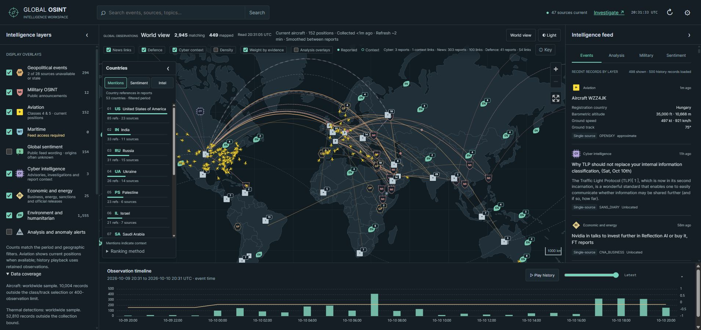
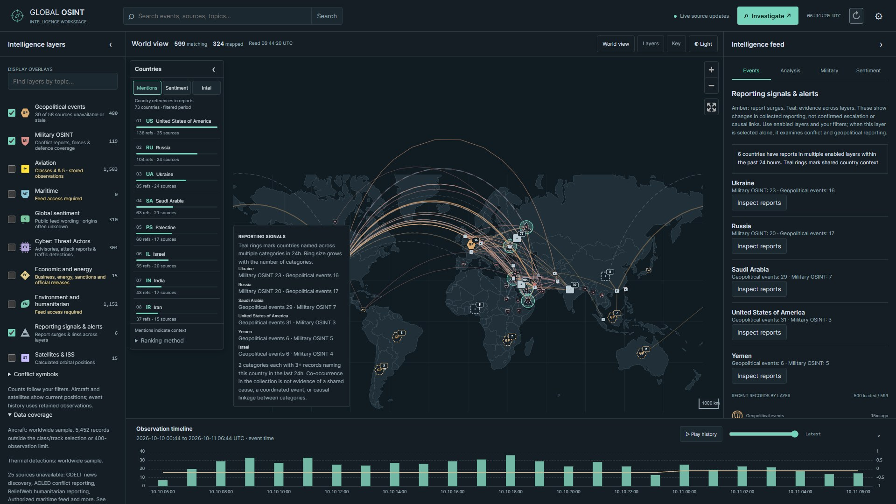
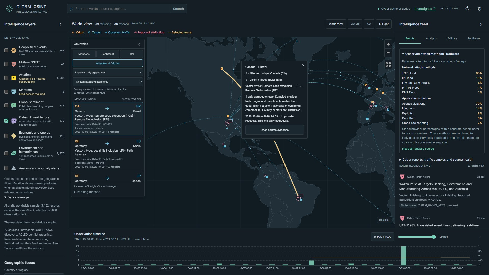
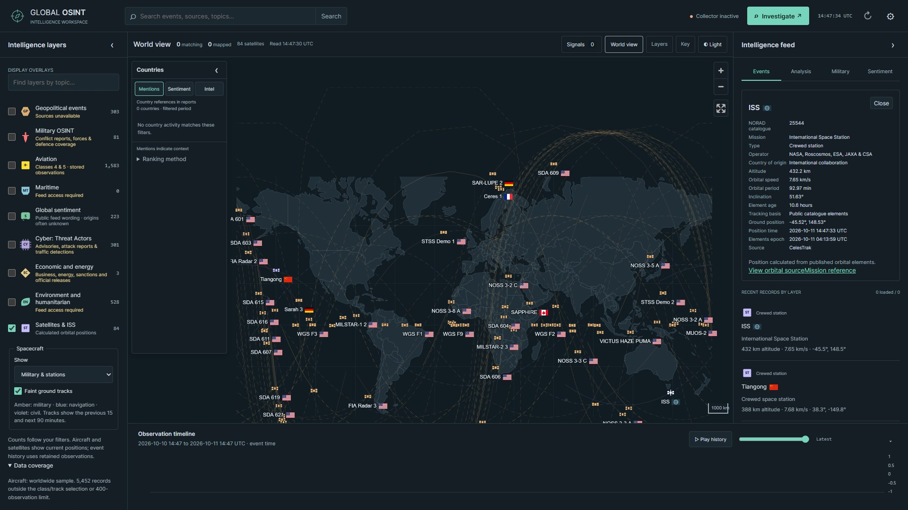
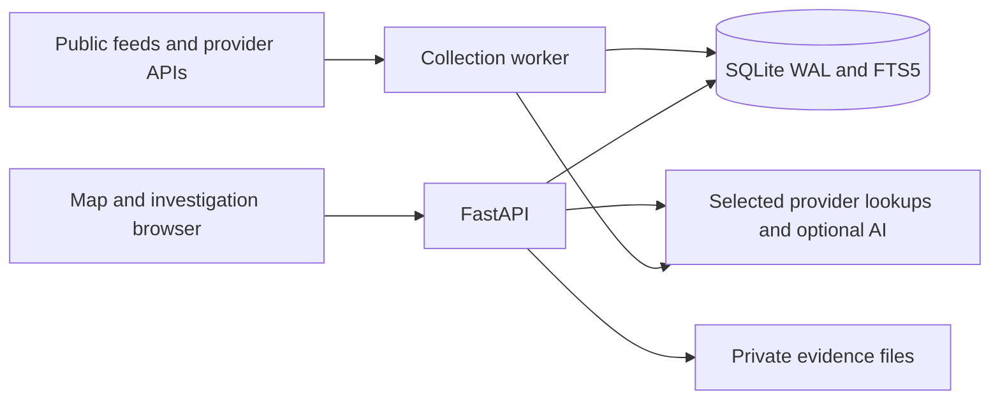

# Signal Atlas OSINT

[](LICENSE)
[](requirements.txt)
[](package.json)

**A global intelligence map and investigation workspace for following public reports, comparing narratives, and tracing relationships back to their sources.**

Signal Atlas brings geopolitical news, defence reporting, aircraft positions, cyber advisories, economic developments and environmental observations into one dashboard. Follow a report from its map marker to the original publication, compare country mentions and sentiment, or preserve evidence in an investigation case.

Collection runs in a separate Python worker. The dashboard reads retained observations from a local database, while the investigation workspace adds search, reference catalogs, evidence snapshots, notes and exports. Most public reporting works without provider keys; aircraft tracking, selected datasets and optional AI require their own credentials. A fresh checkout contains application code and reference geography, with no seeded intelligence records.



_Example from a collected dataset. A fresh installation starts empty and fills as enabled sources succeed. Screenshots show coverage at capture time._

## Contents

- [What you can do](#what-you-can-do)
- [Intelligence layers](#intelligence-layers)
- [Run locally](#run-locally)
- [Using the dashboard](#using-the-dashboard)
- [Investigation workspace](#investigation-workspace)
- [Sources and configuration](#sources-and-configuration)
- [Reading the map correctly](#reading-the-map-correctly)
- [Aircraft details and collection](#aircraft-details-and-collection)
- [How it is built](#how-it-is-built)
- [API examples](#api-examples)
- [Operations and recovery](#operations-and-recovery)
- [Troubleshooting](#troubleshooting)
- [Development and checks](#development-and-checks)
- [Documentation and deployment](#documentation-and-deployment)
- [License](#license)

## What you can do

- **Explore the world map:** distinct layer symbols, heading-oriented yellow aircraft icons, clusters, density overlays, country filters and animated source connections.
- **Follow geopolitical and military reporting:** nine public Liveuamap regional maps, 18 additional publisher feeds, dated ISW assessments and existing worldwide/official reporting. Conflict symbols distinguish drones, missiles, airstrikes, artillery, bombs, sirens, deployments and other report types. Hover summaries show source wording, location, date and confidence; cards retain original citations.
- **Compare countries:** a map-side leaderboard for report mentions, sampled sentiment and intelligence activity, with source and sample counts.
- **Track eligible aircraft:** OpenSky positions with Countries-panel filters for every class the provider reports (all classes by default, individual classes 0-20 from no-information through Large, Heavy, rotorcraft, UAV and obstacles, or registry-flagged military aircraft), refreshed every 30 seconds by default while a visible Aviation layer is selected. Movement interpolates between real observations. Hovers show registration, aircraft model, country, altitude, speed, track and credited photos where available.
- **Follow military satellites and ISS:** public CelesTrak, AMSAT and observer elements cover military, navigation, civil spacecraft and crewed stations. Names precede operator-country flags; hover shows mission, origin, altitude, speed and tracking details. Faint ground tracks highlight on hover. Positions update locally every two seconds; no account or key is needed.
- **Find layers by topic:** search above Display Overlays expands related concepts such as planes, hacking, oil prices and space station. It searches layer meanings locally and preserves your selected overlays.
- **Study public narratives:** English lexical sentiment, topic groups, regional comparisons and separate news, public-discussion and official-statement datasets.
- **Investigate cyber intelligence:** advisories, vulnerabilities, routing and outage observations, plus threat-actor, malware and technique relationships from reference catalogs.
- **Inspect cyber infrastructure:** scheduled DShield observations, optional ThreatFox indicators and bounded ISC honeypot samples retain counts, reporting periods and case evidence. Optional Radar protocol trends and selected-IP GreyNoise lookups keep infrastructure observations separate from actor attribution. See [setup and usage](docs/CYBER_OBSERVATIONS.md).
- **Follow cyber threats:** the merged Cyber: Threat Actors layer combines attack reporting with Bitdefender ATTACK rows, BunkerWeb traffic, Imperva daily request aggregates and Radware's public map. Filter specific attack vectors separately from reputation blocks. Public Unit 42, Securelist and Mandiant article scrapers add technique evidence and CVEs. Radware's global method breakdown is displayed separately from country routes. Infrastructure geography remains separate from human attribution.
- **Collect public discussion without social API keys:** Reddit, Mastodon and Lemmy feeds plus timestamped public Telegram previews flow into the sentiment heatmap. Author origins remain unknown unless explicitly declared; country mentions describe discussion context.
- **Build a case:** indexed search, entity graphs, private notes, immutable evidence snapshots, media/document imports, chronological review and JSON/Markdown exports.
- **Use optional AI analysis:** OpenRouter summaries with source references, caching and local request budgets. Unstructured model output appears as a labelled draft; schema-valid output must pass citation-ID checks.

## Intelligence layers

The ten switches under **Intelligence layers** control the map and matching feed. Search the layer list by topic, then combine the relevant categories. Source health and the selected observation period determine what each layer can display.

| Layer                            | What it displays                                                                                                           | Interpretation and access                                                                                                                      |
| -------------------------------- | -------------------------------------------------------------------------------------------------------------------------- | ---------------------------------------------------------------------------------------------------------------------------------------------- |
| **Geopolitical events**          | Public international reporting, country context and cited source connections                                               | Headline country mentions provide regional context. They do not supply precise incident coordinates.                                           |
| **Military OSINT**               | Official defence announcements, selected conflict reporting, dated assessments and report-type symbols                     | Published reporting can be delayed, incomplete or disputed. Source wording and publication times remain available.                             |
| **Aviation**                     | Current OpenSky aircraft positions, reported track, flight measurements, class filters and optional registry/photo context | Requires OpenSky client credentials and provider credits. Collection follows visible live-view demand.                                         |
| **Maritime**                     | Vessel observations from an administrator-configured normalized AIS feed                                                   | Requires an authorized feed and the schema described in [source configuration](docs/SOURCES.md). No worldwide AIS subscription is bundled.     |
| **Global sentiment**             | Sampled news, public discussion and official wording, with English sentiment and country context                           | Samples and language exclusions are disclosed. Country references differ from author origins.                                                  |
| **Cyber: Threat Actors**         | Advisories, investigations, reported attribution and sampled provider traffic                                              | Combines the application's `cyber` and `threat` categories. Blue traffic routes and pink attribution links retain different evidence meanings. |
| **Cyber infrastructure**         | DShield scan aggregates, opt-in ISC honeypot requests and optional ThreatFox indicators                                    | Teal **CI** symbols show country-located observations. Provider filters and located/unlocated counts are independent of Threat Actors.         |
| **Economic and energy**          | Business reporting, energy releases, sanctions and institutional statements                                                | Reports describe published developments; collected coverage is not a complete market or sanctions database.                                    |
| **Environment and humanitarian** | USGS earthquakes, optional FIRMS thermal detections and ReliefWeb reporting                                                | Source-specific observations retain their precision. FIRMS and ReliefWeb require configured access.                                            |
| **Satellites & ISS**             | Locally calculated positions and ground tracks from public orbital elements                                                | No account is required. Positions are SGP4 estimates; historical satellite tracks are not retained.                                            |

**Reporting signals & alerts** shows regional surges in collected reporting and countries with reports across multiple enabled layers. Use the **Signals** button at the top of the map; it is separate from Intelligence layers. Alerts include comparisons and inspection actions; they are separate from optional AI analysis and do not establish escalation or causation. See [conflict collection and reporting signals](docs/CONFLICT_REPORTING.md). A centered map indicator shows progress for user-triggered computation, including filters and analysis. Routine dashboard refresh and live position updates stay quiet.

<details>
<summary>Preview conflict reporting and signals</summary>



</details>

<details>
<summary>Preview the threat-actor workspace</summary>



Catalog relationships describe published reference knowledge. A name match or shared mention does not establish responsibility for an incident.

</details>

<details>
<summary>Preview the satellite workspace</summary>



Positions are SGP4 estimates from public orbital elements, rather than live spacecraft telemetry. Polar ground positions can fall outside the world overview. Satellite history is not retained. See [orbital collection and accuracy](docs/SATELLITES.md).

</details>

## Run locally

Requires **Python 3.12+**, **Node.js 22.12+** (Node 24 also works), npm and Git. Internet access is needed to collect feeds; the map boundaries are bundled locally. No GPU or local language model is required.

### Windows

Run these commands in PowerShell:

```powershell
git clone https://github.com/abanerjee84/signal-atlas-osint.git
cd signal-atlas-osint
python -m venv .venv
.\.venv\Scripts\python.exe -m pip install --upgrade pip
.\.venv\Scripts\python.exe -m pip install -r requirements-dev.txt
npm ci
Copy-Item .env.example .env
.\START.bat
```

`START.bat` stops this checkout's previous services, starts the API, collector and frontend, then opens [the dashboard](http://127.0.0.1:5173/). Keep its window open; press Enter there to stop all three services. Run it again after changing `.env`. Logs are written to `data/logs/`. It reports missing dependencies or ports occupied by another application. Windows administrator elevation is not required.

### Linux / macOS

```bash
git clone https://github.com/abanerjee84/signal-atlas-osint.git
cd signal-atlas-osint
python3 -m venv .venv
.venv/bin/python -m pip install --upgrade pip
.venv/bin/python -m pip install -r requirements-dev.txt
npm ci
cp .env.example .env
```

Start each service in its own terminal, from the project directory:

```bash
# Terminal 1: API
.venv/bin/python -m uvicorn backend.main:app --host 127.0.0.1 --port 8000
```

```bash
# Terminal 2: source collector
.venv/bin/python -m backend.worker
```

```bash
# Terminal 3: dashboard
npm run dev
```

Open [the dashboard](http://127.0.0.1:5173/), [the investigation workspace](http://127.0.0.1:5173/advanced.html), or [the API reference](http://127.0.0.1:8000/api/docs).

### Services, ports and first startup

| Component     | Development address or command     | Role                                                                                                               |
| ------------- | ---------------------------------- | ------------------------------------------------------------------------------------------------------------------ |
| Frontend      | `http://127.0.0.1:5173/`           | Vite serves the dashboard and investigation workspace and proxies `/api` to port 8000.                             |
| API           | `http://127.0.0.1:8000/api/health` | FastAPI serves retained data, protected actions and generated API documentation.                                   |
| Collector     | `python -m backend.worker`         | Schedules sources, normalizes observations, updates indexes and performs maintenance. It opens no web-server port. |
| Build preview | `http://127.0.0.1:4173/`           | `npm run preview` serves `dist/` and proxies the existing API. Run `npm run build` first.                          |

API and worker initialization apply versioned database migrations. Keep both processes pointed at the same `OSINT_DATABASE`. The API can serve previously collected records while the worker is stopped; new observations and queued investigation jobs require the worker. Frontend changes use Vite's development reload, while backend or `.env` changes require restarting the affected Python processes.

On Windows, the API and collector commands can also be run manually in separate PowerShell terminals using `.\.venv\Scripts\python.exe` in place of `.venv/bin/python`. Use this when inspecting one component's logs. Keep one scheduled worker per database.

After startup:

1. Open the dashboard and inspect source status. Some sources should show successful collection; credentialed sources can remain **Access required** until configured.
2. Select one or two layers and choose **Last 7 days** if the default 24-hour window is empty. Collection, source publication and observation times differ.
3. Open a feed card and follow its citation. A record can be searchable without having a supported map location.
4. Set `OSINT_ADMIN_TOKEN` to use protected investigations, imports, source controls and optional analysis. Leave optional provider keys empty until you need those services.

### Optional browser-based collectors

Some vendor pages need the separate pinned browser renderer. Install it only when using those collectors:

```powershell
.\.venv\Scripts\python.exe -m pip install -r requirements-browser.txt
.\.venv\Scripts\python.exe -m playwright install chromium
```

This Python browser installation serves collection adapters. Frontend browser tests use the Node Playwright installation described under [Development and checks](#development-and-checks). Public RSS, DShield collection and local orbital propagation do not require the browser renderer.

### Bounded collection commands

For a single collection pass, use `python -m backend.worker --once` with the virtual environment's Python executable. Add `--source usgs` to collect only that provider.

If local aircraft disappear while the deployed dashboard works, check that the local collector is still running. The API serves stored data and does not download aircraft on its own. For aviation-only collection alongside an existing API/frontend, run `python -m backend.worker --source opensky` from the project directory; it opens no server port. Avoid running a duplicate collector when the normal worker is already active.

Temporary SQLite write contention is retried without repeating the upstream download. Persistent contention pauses the affected collector lane instead of terminating it; an in-memory deadline preserves the provider's polling interval when the database cannot save the next scheduled run. Non-contention database errors still surface for diagnosis.

Infrastructure collection and country enrichment can be checked separately against the existing database, without starting or replacing the API or Vite server:

```powershell
# Check the enabled DShield source once, respecting its persisted deadline.
.\.venv\Scripts\python.exe -m scripts.collect_observatory --source dshield

# Country lookup for at most 50 existing public-IP indicators; cached results are reused.
.\.venv\Scripts\python.exe -m scripts.geolocate_infrastructure --limit 50
```

The observation collector also accepts `isc_honeypots`, `threatfox` and `cloudflare_radar`; repeat `--source` to select several. Enablement, credentials, database leases and provider cooldowns still apply. For the separate vendor attack-map gathering process, see [collection details](docs/THREAT_MAP_SCRAPERS.md) before running `python -m scripts.collect_threat_maps --watch`.

## Using the dashboard

### Filter and inspect reports

Select layers on the left, choose a country or region, and set the observation period. The **Filter by** control selects occurrence time with publication fallback, publication time, or ingestion time. Custom date ranges use UTC. Search narrows collected events; layer-topic search only finds relevant layer controls.

The map header distinguishes matching records from mapped records. Unknown locations remain in the feed. **Limit results to map view** adds a geographic extent filter, which excludes records without coordinates. Disable it when researching unlocated advisories or indicators. The dashboard loads bounded pages rather than every stored report at once.

Hover a symbol for a summary, source and time. Select it or its feed card to inspect supporting reports, geographic precision, confidence and source metadata. Select a cluster to expand nearby observations. **World view** restores the overview; the toolbar's **Layers** and **Key** controls expose map overlays and explanations.

The timeline shows observation counts by category and the selected period. Historical playback narrows the view to the playhead. Live aircraft collection demand is released while reviewing historical periods. Satellite positions continue to be calculated from the current element snapshot; they are not a historical observation archive.

### Compare countries and reporting signals

The Countries ribbon offers three measures:

| View          | Measures                                         | Use it for                                                                     |
| ------------- | ------------------------------------------------ | ------------------------------------------------------------------------------ |
| **Mentions**  | Country references in retained reporting         | Comparing where the selected reporting directs attention.                      |
| **Sentiment** | Wording scores and sample coverage               | Inspecting the language of sampled English text and its supporting records.    |
| **Intel**     | Activity across selected intelligence categories | Comparing collected observations, including the Cyber infrastructure category. |

With **Cyber: Threat Actors** selected, the ribbon also exposes attacker/victim route evidence and provider filters. Check the route basis before treating an origin as attributed responsibility. **Signals** compares retained reporting volumes and cross-category coverage, with records available for inspection. Neither a surge nor a co-mention establishes causation.

### Inspect cyber infrastructure

Enable **Cyber infrastructure**, then select all observation providers or one provider. The coverage line reports how many matching observations have a location. Teal CI clusters summarize observations, rather than the sum of reported packets, requests or targets. A DShield observation can itself contain thousands of provider reports.

Select a card to inspect the indicator, provider family, reporting interval, retrieval time and provider-specific counts. Located public IPs include the country estimate's source and retrieval time. **Investigate indicator and save evidence** opens the cyber workspace with the indicator query populated; connect there to inspect its history and save evidence to a case.

IP country estimates are displayed at illustrative country centres. Domains, URLs and file hashes remain unlocated; the application does not resolve them or contact observed infrastructure. ISC and DShield share the SANS provider family, so repeated sightings across these sources do not automatically establish independent corroboration. See [cyber observation setup, retention and geography](docs/CYBER_OBSERVATIONS.md).

## Investigation workspace

Open **Investigate** or `/advanced.html` and connect with the server's `OSINT_ADMIN_TOKEN`. The token stays in tab memory and must be entered again after reload. It grants the application's single administrator role; it is not a provider API key.

| Screen                        | Available workflow                                                                                                                                                   |
| ----------------------------- | -------------------------------------------------------------------------------------------------------------------------------------------------------------------- |
| **Search & resources**        | Search indexed local records, apply source/category/language/country/date filters, and choose external research resources explicitly.                                |
| **Cyber intelligence**        | Inspect IP/domain/URL/hash/CVE references, provider observation history, optional GreyNoise context, routing observations, outages and global Radar protocol trends. |
| **Threat actors & campaigns** | Browse aliases, source profiles, malware, techniques and cited historical relationships from MITRE ATT&CK, MISP, Malpedia and ETDA.                                  |
| **Narratives & sentiment**    | Compare lexical topics, languages, source counts and retained discussion wording; save topics for later review.                                                      |
| **Geographic evidence**       | Resolve country references, measure coordinates and import WGS84 GeoJSON with a source, precision and acquisition time.                                              |
| **Image & video evidence**    | Upload authorized PNG/JPEG/MP4 evidence, inspect hashes and metadata, and record verification notes.                                                                 |
| **Entity relationships**      | Inspect extracted co-mentions and add analyst relationships with evidence, status and a stated basis.                                                                |
| **Source monitoring**         | Register permitted public HTTPS pages on an administrator allowlist, then inspect version history and text changes.                                                  |
| **Documents & organizations** | Index authorized document references or text with organization, jurisdiction, version and permission metadata.                                                       |
| **Cross-domain analysis**     | Compare selected records using documented association rules and optionally enqueue an AI assessment.                                                                 |
| **Investigation cases**       | Organize scope, tags, immutable evidence, private notes, chronology, graphs and JSON/Markdown exports.                                                               |
| **Source quality**            | Inspect source ownership, access requirements, freshness, failures and administrator enable/disable controls.                                                        |

A typical case starts with a research question and scope. Search for relevant records, inspect the originals, then save selected evidence to the case. Saved snapshots retain a SHA-256 and remain unchanged when a source record is later revised. Add notes and relationship claims with their evidence basis, review the case timeline, and export the result when ready. Restricted or provider-terms content is exported as provenance metadata where required.

Catalog relationships describe published reference knowledge. A matching malware name or shared indicator does not assign an observed event to a named actor. GeoJSON import does not validate the truth of an asserted location, and media metadata does not certify authenticity. The media tools do not provide deepfake detection or C2PA verification. Full module behavior and limits are documented in [the investigation guide](docs/ADVANCED_OSINT.md).

## Sources and configuration

The public-feed dashboard works without social-media API keys. Copy `.env.example` to `.env` once during setup, then edit the local file. Provider credentials stay on the backend. `.env`, databases, evidence, logs and backups are excluded from Git.

The default registry contains [66 RSS/Atom feeds](docs/RSS_FEEDS.md), plus other public collectors. Source availability is shown separately from event counts. See the [threat and social collection notes](docs/THREAT_ACTIVITY.md) for attribution rules, vendor live-map references and limits.

| Coverage                     | Example sources                                                                                                       | Access                                                                                                                   |
| ---------------------------- | --------------------------------------------------------------------------------------------------------------------- | ------------------------------------------------------------------------------------------------------------------------ |
| Geopolitical news            | BBC regional feeds, Al Jazeera, DW, France 24, UN News, Africanews, MercoPress, CNA, RFI, ABC, Euronews, The Guardian | Public feeds; availability and publisher terms apply                                                                     |
| Military reporting           | UK Ministry of Defence, DVIDS, selected news reports                                                                  | Public announcements and reporting                                                                                       |
| Economic and energy          | BBC Business, Guardian Business/Energy, CNA Business, US EIA, ECB, OFAC                                               | Public feeds and releases                                                                                                |
| Cyber and threat references  | CISA, NCSC, SANS, MITRE ATT&CK, MISP galaxies, Malpedia, ETDA                                                         | Public feeds/catalogs; source-specific reuse terms                                                                       |
| Published attack reports     | BleepingComputer, SecurityWeek, The Hacker News, The Record, Cybersecurity Dive, ESET, Microsoft, Cisco Talos         | Public RSS; unverified excerpt attribution, not live packet telemetry                                                    |
| Sampled cyber detections     | Bitdefender ATTACK table, BunkerWeb blocked-request stream, Imperva daily country-pair dataset                        | No keys. Ten-second live-feed checks; Imperva has a dated daily period and a separate 15-minute check.                   |
| Cyber infrastructure         | DShield daily IP aggregates, ISC web honeypot requests, ThreatFox indicators                                          | DShield is keyless; ISC is opt-in with a narrow filter; ThreatFox requires an Auth-Key.                                  |
| IP country context           | IPwho.is country lookup for retained public-IP observations                                                           | Enabled by default with a local daily request cap and cache; only country centres are displayed.                         |
| Optional cyber enrichment    | GreyNoise selected-IP context and Cloudflare Radar global protocol percentages                                        | Separate credentials and provider access are required; Radar aggregates do not create map incidents.                     |
| Public narratives            | Reddit feeds/archive deliveries and browser imports, Mastodon, Lemmy, public Telegram previews; YouTube channel feeds | No social API keys; selected samples. YouTube uploads are separate from comments. X has no automatic collector connected |
| Environment and humanitarian | USGS, NASA FIRMS, ReliefWeb                                                                                           | USGS is keyless; FIRMS needs a map key; ReliefWeb needs an approved app name                                             |
| Aviation                     | OpenSky state vectors                                                                                                 | Account client credentials and provider credits                                                                          |
| Conflict events              | ACLED                                                                                                                 | Account credentials **and** API entitlement                                                                              |
| Maritime                     | Administrator-configured normalized AIS feed                                                                          | Authorized feed URL and any required credentials                                                                         |
| AI assessment                | OpenRouter                                                                                                            | Optional API key; free-only mode enabled by default                                                                      |

See [source configuration](docs/SOURCES.md) and the in-app source status for schedules, coverage, failures and permission requirements. Historical verification documents describe past checks; they do not guarantee that a provider is available today.

To enable protected analysis, imports and private investigations, set a strong random `OSINT_ADMIN_TOKEN` in `.env`, restart the services, and enter that token in dashboard **Settings** or the investigation workspace's connection form. This is an application access token, separate from Windows privileges and provider keys. The browser holds it in tab memory until reload. Keep `OSINT_ADVANCED_PUBLIC_READ=false` for private investigation records.

Generate a token locally, then copy the result into the private `.env` file:

```powershell
.\.venv\Scripts\python.exe -c "import secrets; print(secrets.token_urlsafe(32))"
```

### Core settings and retention

Settings load from the project-root `.env` and `OSINT_` environment variables; explicit environment variables take precedence. Use JSON syntax for list-valued settings such as `OSINT_EXTRA_ALLOWED_HOSTS=[]`. Copy the example file only on first installation so existing credentials are preserved during upgrades.

| Setting                         | Default                                 | Purpose                                                                                                                  |
| ------------------------------- | --------------------------------------- | ------------------------------------------------------------------------------------------------------------------------ |
| `OSINT_DATABASE`                | `data/osint.sqlite3` under the checkout | Shared SQLite database for the API, worker and operational scripts. Use an absolute path in deployment.                  |
| `OSINT_ADMIN_TOKEN`             | Empty                                   | Enables protected actions when configured. Empty configuration leaves those actions unavailable.                         |
| `OSINT_ADVANCED_PUBLIC_READ`    | `false`                                 | Optional public reads for selected search/cyber/narrative/source endpoints. Cases and private evidence remain protected. |
| `OSINT_EVIDENCE_DIRECTORY`      | `data/evidence`                         | Private media storage outside frontend assets.                                                                           |
| `OSINT_EVIDENCE_RETENTION_DAYS` | `180`                                   | Retention after soft deletion of cases/media. Active case snapshots follow the case evidence policy.                     |
| `OSINT_RAW_RETENTION_DAYS`      | `30`                                    | Retention for raw provider payloads. Normalized records can outlive their raw payload.                                   |
| `OSINT_EVENT_RETENTION_DAYS`    | `180`                                   | General normalized-event retention. Snapshot and source-specific retention can be shorter.                               |
| `OSINT_STATS_RETENTION_DAYS`    | `365`                                   | Daily aggregate retention.                                                                                               |
| `OSINT_CONNECTOR_CONCURRENCY`   | `2`                                     | Maximum concurrent scheduled connectors.                                                                                 |
| `OSINT_HTTP_TIMEOUT`            | `25`                                    | Default outbound request timeout in seconds. Specific adapters can impose tighter bounds.                                |
| `OSINT_MAX_FEED_BYTES`          | `8388608`                               | Default 8 MiB response bound; adapters can use smaller limits.                                                           |
| `OSINT_MAX_RECORDS`             | `1000`                                  | Default per-fetch record bound.                                                                                          |
| `OSINT_MEDIA_MAX_BYTES`         | `20971520`                              | Default 20 MiB private media upload bound. Reverse-proxy limits must match.                                              |

Public discussion uses short-lived snapshots rather than the general event retention period. Infrastructure observations default to 30 days; Radar aggregates have their own 30-day retention. Backups exclude bulk public-discussion snapshots, while evidence deliberately saved in private cases follows case retention. Details are in [operations](docs/OPERATIONS.md) and [cyber observation storage](docs/CYBER_OBSERVATIONS.md).

### Cyber infrastructure settings

| Setting                                  | Default     | Purpose                                                                     |
| ---------------------------------------- | ----------- | --------------------------------------------------------------------------- |
| `OSINT_DSHIELD_ENABLED`                  | `true`      | Initial enablement for daily top-IP collection.                             |
| `OSINT_DSHIELD_LIMIT`                    | `50`        | Bounded top-IP result set, from 1 to 100.                                   |
| `OSINT_ISC_HONEYPOTS_ENABLED`            | `false`     | Initial opt-in for the previous completed UTC day's matching requests.      |
| `OSINT_ISC_HONEYPOTS_USER_AGENT`         | `jndi:ldap` | Narrow request sample filter; it is not a probe sent by the application.    |
| `OSINT_CYBER_OBSERVATION_RETENTION_DAYS` | `30`        | Observation retention, from 1 to 180 days.                                  |
| `OSINT_THREATFOX_AUTH_KEY`               | Empty       | Auth-Key for supported ThreatFox indicator collection.                      |
| `OSINT_GREYNOISE_API_KEY`                | Empty       | Selected-IP context in the investigation workspace; cached for 24 hours.    |
| `OSINT_CLOUDFLARE_RADAR_TOKEN`           | Empty       | Hourly global protocol-percentage aggregates, subject to account access.    |
| `OSINT_INFRASTRUCTURE_GEO_ENABLED`       | `true`      | Enables country lookups for retained public-IP observations.                |
| `OSINT_INFRASTRUCTURE_GEO_DAILY_BUDGET`  | `250`       | Shared local daily request cap, from 0 to 750; provider limits still apply. |
| `OSINT_SANS_CONTACT`                     | Empty       | Optional contact text in the SANS collection User-Agent.                    |

Enablement flags set initial source registration defaults. Existing source choices are retained in the database. To enable ISC on an existing installation, configure the filter, reload the Python services, then enable the source in **Source quality**. Set credentials for optional sources and inspect their access state before expecting records.

Country enrichment runs independently of feed collection, up to ten lookups per minute with serial pacing, a shared lease, a daily budget and persisted backoff. Successful estimates are cached for 24 hours; unknown results for an hour. Disabling new lookups leaves retained estimates available with their provenance and expiry times. Review the IP country provider's terms for your deployment.

### Other provider credentials

| Capability               | Settings                                                                                                     | Notes                                                                                                                                           |
| ------------------------ | ------------------------------------------------------------------------------------------------------------ | ----------------------------------------------------------------------------------------------------------------------------------------------- |
| Aircraft positions       | `OSINT_OPENSKY_CLIENT_ID`, `OSINT_OPENSKY_CLIENT_SECRET`, `OSINT_OPENSKY_BBOX`, `OSINT_OPENSKY_POLL_SECONDS` | Default area is `world`, default polling is 30 seconds, accepted interval is 10 to 1800 seconds. Credentials and provider credits are required. |
| Thermal detections       | `OSINT_FIRMS_MAP_KEY`, `OSINT_FIRMS_AREA`                                                                    | Narrow the area if a worldwide response exceeds collection bounds.                                                                              |
| Humanitarian reports     | `OSINT_RELIEFWEB_APPNAME`                                                                                    | Requires a provider-approved application name.                                                                                                  |
| ACLED events             | `OSINT_ACLED_EMAIL`, `OSINT_ACLED_PASSWORD`                                                                  | Account credentials also need API entitlement.                                                                                                  |
| Maritime feed            | `OSINT_MARITIME_URL`, `OSINT_MARITIME_TOKEN`                                                                 | Administrator-supplied authorized normalized feed. Its host must satisfy outbound policy.                                                       |
| Public source monitoring | `OSINT_WATCH_ALLOWED_HOSTS`                                                                                  | Exact approved public HTTPS hostnames; the UI also records permission basis.                                                                    |
| Additional feeds         | `OSINT_EXTRA_RSS`, `OSINT_EXTRA_ALLOWED_HOSTS`, `OSINT_SOCIAL_FEEDS`                                         | JSON definitions and exact hostname allowlists; see [source schemas](docs/SOURCES.md).                                                          |
| Public discussion/video  | `OSINT_REDDIT_SUBREDDITS`, `OSINT_TELEGRAM_CHANNELS`, `OSINT_YOUTUBE_CHANNELS`                               | Selected public samples. Configuring a list replaces that setting's default list. YouTube feeds supply uploads, not comments.                   |
| External search          | `OSINT_SEARXNG_URL`                                                                                          | Optional administrator-configured public HTTPS instance with JSON search support.                                                               |

### Optional AI analysis

Set `OSINT_OPENROUTER_API_KEY` to enable remote model analysis. The default `OSINT_OPENROUTER_MODEL=openrouter/free` and `OSINT_AI_FREE_ONLY=true` require zero prompt and completion prices in the provider model catalog. `OSINT_OPENROUTER_FALLBACK` is empty by default. Model availability still depends on the provider account and current catalog.

`OSINT_AI_DAILY_BUDGET=40` limits outbound completion attempts per UTC day, including retries and failures. `OSINT_ADVANCED_AI_DAILY_BUDGET=20` adds a separate advanced-analysis enqueue budget. `OSINT_ADVANCED_LOOKUP_DAILY_BUDGET=100` limits queued public lookups, while IP country enrichment has its separate budget. These controls count requests rather than money. Cached analysis does not require a new completion attempt; `OSINT_AI_CACHE_DAYS=7` controls its retention.

Analysis sends a bounded evidence packet to the configured remote provider. Structured responses must reference event/report IDs from that packet. A usable plain-text response is displayed as a labelled unvalidated draft. Citation checks establish reference membership, so the analyst must still compare each claim with its cited evidence. The model cannot set evidence confidence or execute commands. No GPU or local language model is required for the normal application.

For every supported setting and its validation bounds, read [the example environment](.env.example) and [the settings model](backend/config.py). Provider schedules, source metadata and configuration schemas are documented in [SOURCES.md](docs/SOURCES.md).

## Reading the map correctly

Reported coordinates, country context and publisher origin have different meanings. A country mentioned in a headline is regional context, not a confirmed incident location. Map edges can indicate publisher-to-context links, co-mentions or documented reference relationships; inspect their source and basis before interpreting them.

Cyber traffic routes are blue; reported attacker-to-victim attribution links are pink. An infrastructure country never establishes the attacker's nationality. Vendor samples are shown separately from published reports and are not global attack totals. Natural Earth reference points supplement countries omitted by the low-detail boundary file, without creating boundary polygons. See [the scraper analysis](docs/THREAT_MAP_SCRAPERS.md).

With **Cyber: Threat Actors** active, the Countries ribbon offers an **Attacker → Victim** table with provider filters. Small A/V markers, moving arrows, a top legend and hover evidence identify origins, targets and source reports. A separate gathering thread checks live feeds every ten seconds against the running database, without opening a server port: `python -m scripts.collect_threat_maps --watch`. Install the optional pinned `requirements-browser.txt` renderer and Chromium for the Bitdefender table and normal Imperva page. Imperva rows preserve their daily period and request counts; choose **Last 7 days** for older reports. Arrows illustrate direction rather than packet timing. See [collection details and graceful gatherer shutdown](docs/THREAT_MAP_SCRAPERS.md). Provider backoff still applies.

Route rows, hover previews and selected routes show **Vector / type** using the provider's category or blocking reason. Generic Bitdefender ATTACK rows remain **Not specified by provider**; they do not establish a technique. The compact toolbar keeps overlay switches in **Layers** and explanations in **Key**. World view fits the canvas beside the Countries ribbon, excluding polar cartography above 74°N and below 57°S; collapsing the ribbon refits the overview without resetting a selected route or a manual view.

Sentiment describes the wording of sampled English text. It does not measure national opinion, verify a claim or identify a person's stance. Unknown origins stay unknown. Non-English reports remain available without an English sentiment score.

Aircraft positions are a bounded geographic sample of eligible OpenSky classes, with network coverage gaps and source timestamps. Ground track is movement direction, not necessarily nose heading. Registration country is not departure origin; departure and destination airports are unavailable from state vectors. Animation interpolates between observations without extrapolating a future route.

Collection success and citation validation do not establish truth. AI drafts are labelled as unvalidated, and structured citation checks confirm that references belong to the evidence packet. Zero counts can mean no matching reports, an unavailable source or missing access; check source health and the time filter.

## Aircraft details and collection

OpenSky remains the source of aircraft positions and flight measurements. Its documented live API does not include photos. The aircraft detail helper accepts an ADS-B callsign and verifies the ICAO24 address before attaching a registration, type, model or photo. It uses Airplanes.live’s public callsign lookup and aircraft registry; credited photographs come from Planespotters.net, the same photo source supported by both providers’ map code. No additional key or browser scraper is required. If callsign lookup is blocked or ambiguous, an existing OpenSky ICAO address can still identify the registry record. Photos are optional: missing or failed images do not prevent flight details from displaying.

```powershell
.venv\Scripts\python.exe -m backend.aircraft_details --callsign BFLO76 --icao24 7cf9cd
```

The normal worker runs the helper independently of position collection. It publishes ignored runtime data in `public/aircraft-details.json` and `public/aircraft-live.json`; collection keeps up to 1,000 positions balanced across classes and geographic cells, registry records are cached for a day, photos for a week, and upstream rejections receive a shared backoff. A standalone `python -m backend.aircraft_details --watch` can fill this file without opening a server port. Military selection uses the Airplanes.live registry military flag; unknown flags are excluded, and no nationality or callsign inference is made. All-classes includes unclassified aircraft with valid reported tracks. Changes to the running collector require its next reload; the static live snapshot also lets the frontend show broader classes while an older API remains running. Do not run it alongside a worker unnecessarily; a shared database lease prevents overlapping batches. Production Nginx serves the runtime file directly and permits images only from `t.plnspttrs.net`; copy the updated Nginx configuration on deployment.

A visible live Aviation layer renews a short per-tab collection lease every ten seconds. Deselecting the layer, hiding the tab or entering historical playback releases demand. Closing a disconnected tab expires its lease after 35 seconds. Multiple viewers share one collector, and one viewer closing does not stop another viewer’s updates. The default OpenSky collection interval is 30 seconds; retained history remains at 30-minute intervals. Provider errors and quota retry headers still take precedence. Collection must fit the credit allowance of the configured OpenSky account; adjust the polling interval and geographic scope to that allowance.

These demand controls require the updated API and worker code to be loaded. Changing files alone cannot activate them in a resident API launched without reload mode. A collector run with `--once` remains an explicit manual collection, independent of viewer leases.

References: [OpenSky live fields and credit limits](https://openskynetwork.github.io/opensky-api/rest.html), [Airplanes.live callsign lookup](https://airplanes.live/api-docs/), [OpenSky map photo integration](https://github.com/openskynetwork/tar1090/blob/master/html/script.js).

## How it is built

The frontend uses **vanilla JavaScript, Vite, MapLibre GL and ECharts**. **FastAPI** serves a **SQLite WAL** database with FTS5 search. A separate Python worker normalizes feeds, records provenance and schedules collection. Optional OpenRouter requests run on the server.



The worker validates source records, retains provenance, applies conservative deduplication and updates the shared investigation index. Daily IP aggregates retain provider identity and reporting day; repeated polling revises that observation instead of creating an independent incident. Source families remain available when comparing sightings.

Database leases prevent overlapping source jobs. The scheduler persists next-run times and provider backoff, bounds downloads and batch writes, and retains previous successful observations when a new fetch fails. Current aircraft reads, registry details, orbital snapshots and infrastructure country enrichment have separate scheduling lanes. The API serves database reads and explicit user actions; it does not run scheduled feed collection.

```text
backend/       API, collectors, analysis, investigation modules and migrations
src/           Map, timeline, feeds, country rankings and investigation UI
public/        Local country boundaries, map attribution and favicon
scripts/       Launcher, maintenance, backups, audits and verification tools
deploy/        Ubuntu systemd services, timers and Nginx configuration
tests/         Backend, Node and browser tests
docs/          Architecture, source notes, operations and verification records
```

The original [build contract](BUILD_CONTRACT.md) and [advanced integration specification](ADVANCED_OSINT_SPEC.md) describe the project requirements. The main API uses `/api/`; investigation modules use `/api/v1/`.

### Evidence, geography and storage

An event groups supporting reports, each of which retains its source, original URL, time fields and normalized metadata. Source revisions update the retained record; a case snapshot preserves the evidence as it was saved. Raw payload retention and case retention are separate. FTS5 indexes searchable records rather than fetching the web during local search.

Confidence and severity measure different things. Default provider reporting is **Single-source**. Provider-reviewed instrumental observations or authoritative catalog membership can qualify for **Verified** under documented rules. **Corroborated** and **Disputed** require cited reports and an authenticated analyst's recorded independence or contradiction assessment. A successful fetch, repeated provider count or AI response does not upgrade a report automatically. See [evidence classification](docs/ARCHITECTURE.md#evidence-classification).

Reported coordinates, headline country context, infrastructure country estimates, publisher origins and catalog relationships retain their distinct geographic basis. Unknown locations stay unknown. Country boundaries and reference points are bundled locally; the optional infrastructure-country lookup contacts the approved country provider for public IPs, without resolving indicator domains or contacting observed hosts.

The schema is versioned under `backend/migrations/`. Migration 007 adds typed infrastructure observations and Radar aggregates; migration 008 separates infrastructure events into their own map category without changing event/report IDs. Back up an existing installation before upgrading because there is no automatic schema downgrade.

## API examples

The local API reference is [Swagger UI](http://127.0.0.1:8000/api/docs), with the generated schema at [`/api/openapi.json`](http://127.0.0.1:8000/api/openapi.json). Vite proxies the same `/api` routes, so the frontend and direct API share one backend.

| Route                                            | Use                                                            | Access                                         |
| ------------------------------------------------ | -------------------------------------------------------------- | ---------------------------------------------- |
| `GET /api/health`                                | Database/API health                                            | Public read                                    |
| `GET /api/status`                                | Source states, worker heartbeat and storage                    | Public read                                    |
| `GET /api/layers`                                | Map category definitions, sources and freshness                | Public read                                    |
| `GET /api/events`                                | Filtered events or GeoJSON, with matching and located counts   | Public read                                    |
| `GET /api/events/{event_id}`                     | Supporting reports, time fields and evidence basis             | Public read                                    |
| `GET /api/infrastructure/coverage`               | Located/unlocated infrastructure totals for the active filters | Public read                                    |
| `GET /api/aviation/live`                         | Bounded current aircraft snapshot                              | Public read                                    |
| `GET /api/country-activity`                      | Country leaderboard data                                       | Public read                                    |
| `GET /api/v1/osint/search`                       | Indexed investigation search                                   | Protected by default                           |
| `GET /api/v1/cyber/observations`                 | Typed provider observation history                             | Protected by default                           |
| `GET /api/v1/cyber/indicators/{id}`              | Indicator evidence and related references                      | Protected by default                           |
| `GET /api/v1/cyber/ddos`                         | Global Radar protocol trend measurements                       | Protected by default                           |
| `POST /api/admin/connectors/{source_id}/refresh` | Request a scheduled source collection                          | Administrator token                            |
| `POST /api/ai/analyze`                           | Request bounded source-grounded analysis                       | Administrator token and configured AI provider |

Public event requests can combine `categories`, `q`, `country`, `start`, `end`, `bbox` and `time_basis`. Dates must include a timezone. `categories=infrastructure` selects the new layer; `infrastructure_provider=dshield` filters its provider. The merged Threat Actors UI uses `categories=cyber,threat` when requesting both underlying categories.

```bash
# Check that the API can read its database.
curl --fail http://127.0.0.1:8000/api/health

# Retrieve a bounded infrastructure event page.
curl --fail 'http://127.0.0.1:8000/api/events?categories=infrastructure&infrastructure_provider=dshield&limit=20'

# Return located records in GeoJSON form.
curl --fail 'http://127.0.0.1:8000/api/events?categories=infrastructure&format=geojson&limit=100'

# Inspect country-estimate coverage without fetching a provider.
curl --fail 'http://127.0.0.1:8000/api/infrastructure/coverage?infrastructure_provider=dshield'
```

PowerShell can use `Invoke-RestMethod -Uri 'http://127.0.0.1:8000/api/health'` or `curl.exe` for the curl examples. Protected requests use `Authorization: Bearer <OSINT_ADMIN_TOKEN>`. Do not send provider credentials as the application bearer token.

Event pages default to 500 and cap at 1,000 records per request, with offset pagination. Counts cover the matching dataset, so a page length is not the total. GeoJSON omits unlocated records while retaining coverage counts. Investigation collections use `data`/`meta` envelopes and their own bounded pagination. Exact request fields and response schemas are in the generated OpenAPI document; [API.md](docs/API.md) and [the investigation API guide](docs/ADVANCED_OSINT.md#versioned-api) explain semantics.

## Operations and recovery

Check `/api/health` for API/database access and `/api/status` for the worker heartbeat, source failures and freshness. An API can be healthy while one provider is unavailable. The in-app Source quality screen exposes the same distinction. Windows launcher logs are under `data/logs/`; deployed services use the system journal.

### Back up and restore

Use the online backup tool for a consistent database and active private media bundle:

```powershell
.\.venv\Scripts\python.exe scripts\backup.py --destination data\backups --keep 7
```

The tool verifies database integrity and writes a SHA-256 manifest. Credentials are excluded, and bulk public-discussion snapshots are omitted under the backup policy. Protect the resulting bundle as private evidence. A copied live `.sqlite3` file alone is not a consistent backup of an active WAL database.

Restore a selected bundle into a **new directory**:

```powershell
.\.venv\Scripts\python.exe scripts\backup.py --restore data\backups\BUNDLE_DIRECTORY --destination data\restore-check
```

Replace `BUNDLE_DIRECTORY` with a bundle created by the backup tool. The restore command refuses an existing target. Validate the recovered database and evidence in isolation before changing service paths. Production replacement requires stopped writers, preservation of the current database and sidecars, and the matching application version. See [recovery instructions](docs/OPERATIONS.md#restore).

### Maintenance and upgrades

The worker runs retention and SQLite optimization hourly. For a deliberate maintenance pass under the same configuration:

```powershell
.\.venv\Scripts\python.exe scripts\maintenance.py
```

This command applies configured expiration policies. SQLite does not return all freed pages to disk immediately; full vacuuming is a separate maintenance-window operation. Keep room for the database, WAL, private media and backups.

Before an upgrade, create a verified backup, preserve the current source/build and lockfiles, then stop the affected services. Install the new dependencies, build the frontend and restart API/worker with the intended environment. Migrations run during initialization. Frontend-only changes require rebuilding deployed assets; backend changes require loading the new Python code. On a development checkout, Vite handles frontend changes while it is running.

## Troubleshooting

| Symptom                                    | Check and action                                                                                                                                                     |
| ------------------------------------------ | -------------------------------------------------------------------------------------------------------------------------------------------------------------------- |
| Dashboard opens with no records            | Confirm that the collector is running, inspect source states, widen the period and clear country/viewport filters. New installations start empty.                    |
| Matching count is higher than mapped count | Some records have no supported location. Inspect them in the unrestricted feed; a map-extent filter excludes them.                                                   |
| Cyber infrastructure is empty              | Enable the layer and select all providers or DShield. Check collection health and time range. ISC is opt-in; ThreatFox requires credentials.                         |
| Infrastructure records have no country     | Inspect the located/unlocated count, lookup configuration, daily budget and provider cooldown. Domains, URLs and hashes intentionally remain unlocated.              |
| Source shows Access required               | Configure the required backend credentials or approved app name, restart the Python services, and inspect the source's enabled state.                                |
| Aircraft stop updating                     | Keep a visible live Aviation layer open, verify OpenSky access/credits and worker heartbeat, and exit historical playback. The API alone does not collect aircraft.  |
| Protected workspace cannot connect         | Set `OSINT_ADMIN_TOKEN`, restart the API and use that exact token in the connection form. Re-enter it after browser reload.                                          |
| Map has no countries or symbols            | Inspect the console and network panel. Serve the complete `dist/` tree, local geography and MapLibre `.mjs` worker with the correct MIME type and CSP.               |
| Port 5173 or 8000 is occupied              | Inspect the owning process. The launcher only manages this checkout's recorded services; stop or reconfigure an unrelated application yourself.                      |
| Provider returns 429                       | Wait for its persisted retry deadline. Dashboard refresh does not override provider backoff or quotas.                                                               |
| TLS validation fails                       | Repair the local trust chain. Outbound HTTP uses certifi public roots plus installed system roots, with certificate and hostname verification enabled.               |
| SQLite is busy                             | Check for duplicate workers, persistent writers, disk space and permissions. Do not delete live WAL/SHM files to clear a lock.                                       |
| Optional AI fails                          | Inspect provider configuration, free-model availability, local budgets and source evidence. Search, deterministic comparisons and retained records remain available. |

Additional source-specific conditions and production diagnostics are covered in [OPERATIONS.md](docs/OPERATIONS.md).

## Development and checks

Using the Windows virtual environment:

```powershell
.\.venv\Scripts\python.exe -m pytest -q
.\.venv\Scripts\python.exe -m ruff check backend tests
node --test tests/*.test.mjs
npm run build
npx playwright install chromium
npm test
```

On Linux/macOS, substitute `.venv/bin/python`. Backend tests use temporary databases and mocked provider responses. Node tests cover map math, aircraft motion, symbols, topic search and evidence presentation. The build creates both dashboard and investigation entry points in `dist/`.

The standard browser configuration starts or reuses the local API and frontend, without starting a collection worker. Browser fixtures intercept selected network responses; some workspace checks also require retained live data. A clean database will not satisfy assertions that expect collected infrastructure observations. Keep synthetic fixtures isolated from the live intelligence database.

For the focused cyber checks against servers that are already running:

```powershell
.\node_modules\.bin\playwright.cmd test --config playwright.existing.config.js
```

This configuration never starts or replaces application servers. It checks provider observations and Radar states with browser-only fixtures, and verifies actual infrastructure map clusters and provider filters using retained live observations. The live layer check expects DShield records with country estimates and no ThreatFox records; use an appropriate development dataset. See [cyber validation](docs/CYBER_OBSERVATIONS.md#validation).

Dependency audits can be run with the virtual environment's `python scripts/audit.py` and `npm audit`. Provider integration checks make outbound requests and have different access requirements from isolated unit tests; review the relevant script and [testing guide](docs/TESTING.md) before running them.

## Documentation and deployment

- [Architecture and evidence rules](docs/ARCHITECTURE.md)
- [Map symbols, connections and country rankings](docs/MAP_INTERFACE.md)
- [Investigation workspace](docs/ADVANCED_OSINT.md)
- [Threat intelligence sources and relationships](docs/THREAT_INTELLIGENCE.md)
- [Cyber infrastructure observations, provider setup and map geography](docs/CYBER_OBSERVATIONS.md)
- [Threat Observatory integration assessment](docs/THREAT_OBSERVATORY_INTEGRATION_REVIEW.md)
- [World Monitor feature catalog](docs/WORLDMONITOR_FEATURE_CATALOG.md) and [Signal Atlas incorporation plan](docs/WORLDMONITOR_INCORPORATION_PLAN.md)
- [Social narratives and military reporting](docs/SOCIAL_MILITARY.md)
- [Conflict collection, symbols and reporting signals](docs/CONFLICT_REPORTING.md)
- [Conflict tracker and upstream publisher audit](docs/CONFLICT_SOURCE_AUDIT.md)
- [Aircraft refresh, card metadata and AI drafts](docs/AIRCRAFT_ECONOMIC_AI_UPDATE.md)
- [Satellite collection, propagation and accuracy](docs/SATELLITES.md)
- [Performance measurements and optimization](docs/PERFORMANCE.md)
- [API guide](docs/API.md)
- [Operations, backups and recovery](docs/OPERATIONS.md)
- [Ubuntu deployment](docs/DEPLOYMENT.md)
- [Testing and recorded measurements](docs/TESTING.md)
- [Configured RSS and Atom directory](docs/RSS_FEEDS.md)
- [Threat attribution, live-map review and public social collection](docs/THREAT_ACTIVITY.md)
- [Implementation status and remaining acceptance work](docs/STATUS.md)

The Windows launcher is for local development. Ubuntu deployment includes systemd services, backup/monitoring timers and an Nginx HTTPS configuration. Acceptance testing on the intended production host remains necessary. Private investigations currently use a single administrator principal; multi-user accounts and roles are not implemented.

Production serves the complete compiled `dist/` tree through Nginx and keeps FastAPI bound to localhost. The worker runs as a separate systemd service. Configuration lives in `/etc/osint/osint.env`, database and evidence under `/var/lib/osint`, and backups under `/var/backups/osint`. Node and Vite are build tools rather than resident production services.

Follow [the Ubuntu deployment guide](docs/DEPLOYMENT.md) for the service account, file ownership, TLS, proxy configuration, module-worker MIME types, security headers and timers. The provided guide targets Ubuntu 24.04 LTS with Python 3.12 and an 8 GB host. It records the outstanding target-host acceptance work; a local build or short benchmark does not complete deployment acceptance.

Contributions are welcome through issues and pull requests. For a new connector, document its access requirements, terms, timestamp semantics and geographic precision, and test normalization and failure handling. Never include provider credentials or private evidence in a contribution.

## License

Project code is licensed under the [MIT License](LICENSE), copyright 2026 Abhijit Banerjee.

Third-party dependencies, provider content and reference data retain their own licenses and terms. Natural Earth country boundaries are public domain; see [map attribution](public/MAP_LICENSE.txt). MITRE ATT&CK material retains [MITRE's license and notice](docs/licenses/MITRE-ATTACK.txt). The project license does not grant redistribution rights to collected news, social posts, aircraft data or other provider content.
