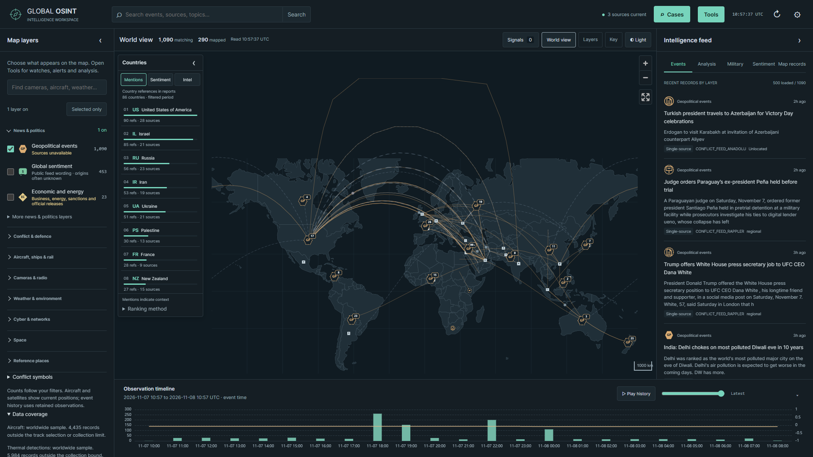
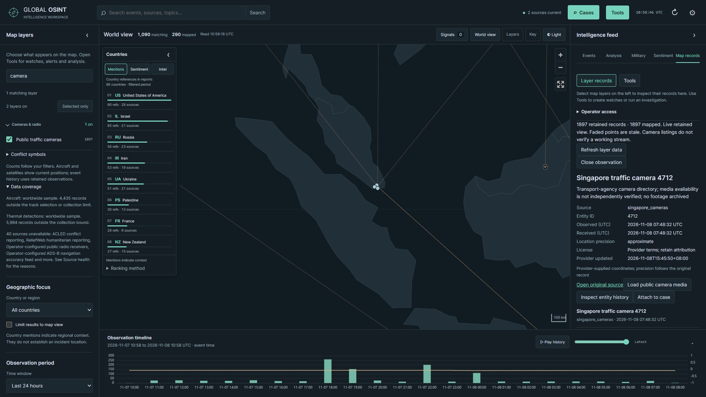
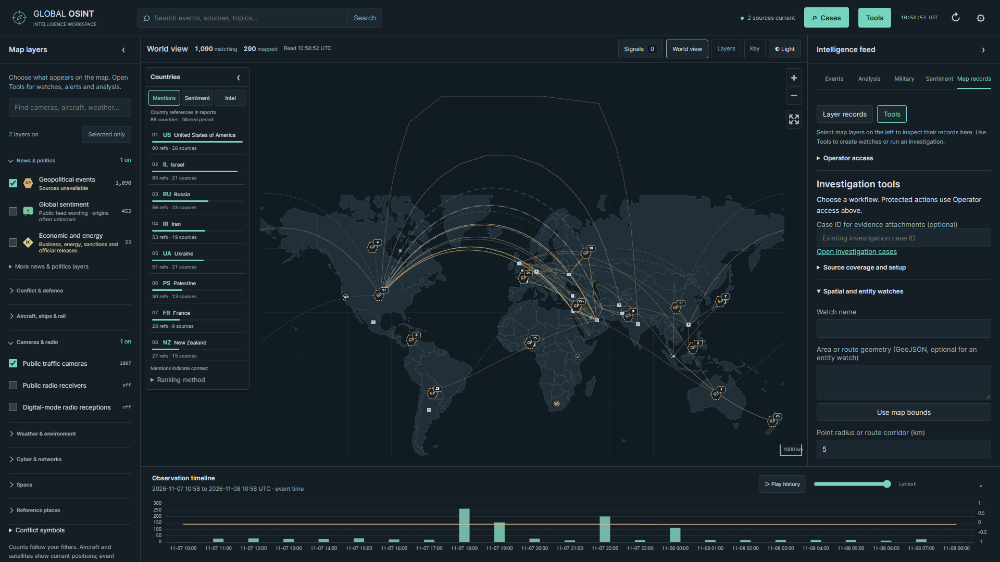
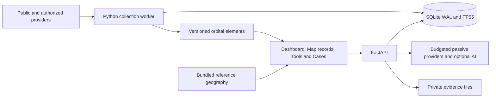

# Signal Atlas OSINT

[](LICENSE)
[](requirements.txt)
[](package.json)

**A public-source intelligence map, monitoring dashboard and investigation workspace.**

Signal Atlas collects international reporting, aircraft and vessel observations, environmental measurements, cyber intelligence and public discussion. Explore the map, inspect the original evidence, replay retained observations, save watch rules, or build a private investigation case.

The interface has four roles: **Map layers** chooses map content, **Map records** inspects specific feed records, **Tools** runs monitoring and analysis workflows, and **Cases** holds saved investigations. Collection runs in a separate Python worker; the browser reads retained data through FastAPI.



_Current interface captured on 8 November 2026 using real collected public-source data. Counts and headlines describe that capture, not guaranteed coverage. A new installation starts without seeded intelligence records. [Capture details](docs/screenshots/capture.json)._

## Contents

- [Interface and navigation](#interface-and-navigation)
- [Capabilities](#capabilities)
- [Screenshots](#screenshots)
- [Run locally](#run-locally)
- [Sources and access](#sources-and-access)
- [Configuration](#configuration)
- [Watches, history and evidence](#watches-history-and-evidence)
- [Imagery and measured change](#imagery-and-measured-change)
- [Architecture and codebase](#architecture-and-codebase)
- [API](#api)
- [Data interpretation and limits](#data-interpretation-and-limits)
- [Operations and deployment](#operations-and-deployment)
- [Testing and screenshot capture](#testing-and-screenshot-capture)
- [Documentation](#documentation)
- [License](#license)

## Interface and navigation

| Control                  | What it does                                                                         | Where to find it                                             |
| ------------------------ | ------------------------------------------------------------------------------------ | ------------------------------------------------------------ |
| **Map layers**           | Select map content; search topics and review active choices                          | Left sidebar                                                 |
| **Selected only**        | Show enabled controls without changing their selections                              | Above the layer groups                                       |
| **More layers**          | Reveal narrower views within a topic                                                 | Inside applicable groups                                     |
| **Map records**          | Inspect specific feed records, timestamps, precision, sources and source health      | Right-hand feed tabs; opens when a specific feed is selected |
| **Tools**                | Open watches, alerts, entity history, imagery, imports, exposure and passive lookups | Top bar                                                      |
| **Cases**                | Open indexed search, evidence, notes, graphs and saved investigations                | Top bar; `/advanced.html`                                    |
| **Signals**              | Inspect reporting surges and evidence across enabled categories                      | Map toolbar                                                  |
| **Observation timeline** | Set the playhead for retained reporting and monitoring history                       | Below the map                                                |
| **Settings**             | Enter the dashboard access token and adjust settings                                 | Top-right gear                                               |

The layer picker uses eight topic groups: **News & politics**, **Conflict & defence**, **Aircraft, ships & rail**, **Cameras & radio**, **Weather & environment**, **Cyber & networks**, **Space**, and **Reference places**. Groups show how many controls are on. Search opens matching groups; Selected only keeps active choices easy to review.

Broad subjects share one category switch instead of exposing duplicate switches for different internal APIs. Saved broad monitoring selections migrate to those categories. Specific views, such as airborne aircraft, warnings, trains or radio receptions, remain inside their topics. Reporting categories populate Events; specific monitoring feeds populate Map records. Their counts retain their original meanings.

Country selection, map-extent filtering, the period and topic search narrow the display. Clear geographic restrictions to inspect unlocated records and warning polygons: the integrated monitoring geography filter currently selects point observations and states this limit in its records panel.

`/monitoring.html` remains an optional dedicated monitoring workspace with independent layer/time controls and an explicit **Dashboard** return link. The main dashboard provides the normal map and Tools workflow.

## Capabilities

The default code configuration registers **212 source definitions**. The monitoring API exposes **58 overlapping observation sublayers**; the main picker combines overlapping broad views. Registered definitions, enabled sources, recently successful feeds and map views are different counts. Check source health for collection status and access requirements.

| Domain                   | Current implementation                                                                                                             | Coverage and access                                                                                         |
| ------------------------ | ---------------------------------------------------------------------------------------------------------------------------------- | ----------------------------------------------------------------------------------------------------------- |
| International reporting  | Publisher RSS/Atom, GDELT discovery, official statements, country context and source connections                                   | Reporting can be delayed, inaccessible or geographically imprecise                                          |
| Conflict and defence     | Regional Liveuamap collection, ISW assessments, defence publishers, official channels and report-type symbols                      | Source wording is retained; reporting does not establish a verified live military position                  |
| Aircraft                 | OpenSky observations, classes 0-20, registration/model context, credited photos, trails and retained history                       | Credentials and provider credits required; live collection follows visible viewer demand                    |
| Maritime                 | AIS Stream when keyed, anonymous OpenSeaFeed/Open Waters fallbacks, optional BarentsWatch and configured normalized AIS            | Receiver coverage, regional limits, provider availability and credentials vary                              |
| Vessel identity/activity | Registry enrichment and optional GFW fishing, encounter, loitering, port-visit and gap events                                      | GFW token required; apparent activity is separate from AIS fixes and legality findings                      |
| Space                    | CelesTrak/AMSAT/observer elements, local SGP4 propagation, military/navigation/station views, ground tracks and SatNOGS references | Calculated positions, not live spacecraft telemetry; elements can be stale                                  |
| Cameras and radio        | TfL, Caltrans, NYC and Singapore camera metadata; configured receivers, KiwiSDR and scoped PSKReporter receptions                  | Media is opt-in; directories do not verify working streams; PSKReporter needs a callsign                    |
| Satellite receptions     | TinyGS adapter and authorized reception imports                                                                                    | Anonymous access was not verified; token/authorized export required; orbital estimates are not receptions   |
| Regional rail            | Amtraker US passenger trains and Digitraffic Finland positions                                                                     | Regional observations, not worldwide rail coverage                                                          |
| Environment              | USGS, optional FIRMS/ReliefWeb, NWS polygons, SWPC, OpenAQ and GVP volcano references                                              | NWS jurisdictional coverage; OpenAQ key/location IDs required; registry entries are not eruption detections |
| GNSS accuracy            | Cells derived from supported reported airborne NACp samples                                                                        | Needs an authorized accuracy-capable ADS-B feed; low accuracy is not confirmed jamming                      |
| Cyber intelligence       | Advisories, vulnerabilities, threat catalogs, attack reporting, DShield, ThreatFox, Feodo and URLhaus                              | Optional credentials apply; infrastructure observations remain separate from actor attribution              |
| Network context          | Outage/routing adapters and RIPE Atlas public probe states                                                                         | A probe state or country aggregate does not establish outage cause or exact incident site                   |
| Narratives               | Separate news, public-discussion and official samples; lexical sentiment and optional EUvsDisinfo RSS                              | Sampling, language limits and editorial attribution are retained; country mentions are not author origins   |
| Reference places         | Versioned installations, ports, nuclear plants, spaceports, terminator, optional WRI and authorized asset imports                  | Reference geometry does not establish current activity, damage or dependency                                |
| Watches and cases        | Spatial/entity rules, alerts, history, snapshots, notes, graphs and exports                                                        | Private actions use the application administrator token                                                     |
| Imagery and assessments  | Sentinel-2 and OPERA catalogs, previews, published assessment imports, bounded water/NDVI comparisons                              | Acquisition-dated products; optional raster dependencies and protected-asset access apply                   |
| Passive recon            | Shodan, public DNS, RDAP, CT, Wikidata and OFAC candidates                                                                         | Authenticated, budgeted and passive; no target scanning or automatic identity merge                         |

The [expansion guide](docs/SHADOWBROKER_EXPANSION.md) documents all 15 additions, source IDs, import schemas, budgets and processing limits. [Provider contracts](docs/SHADOWBROKER_PROVIDER_CONTRACTS.md) record source formats and verification findings.

## Screenshots

These images show the current application, not generated mockups. They use a fresh isolated browser context, actual retained public records and empty operator/private-case fields. Provider media and private case APIs were not opened during capture.

<details>
<summary>Public camera records on the main map</summary>



_Camera metadata and provider location are inspectable alongside the main map. Public camera media loads on request; footage is not archived._

</details>

<details>
<summary>Tools and spatial/entity watch setup</summary>



_Tools opens actions directly. Saved watches, imports, lookups and evidence attachments require Operator access._

</details>

[View the layer picker at full resolution](docs/screenshots/map-layers-current.png). The [capture manifest](docs/screenshots/capture.json) records the application revision, UTC time, viewport and source counts used for these images.

## Run locally

Requires **Python 3.12+**, **Node.js 22.12+** (Node 24 also works), npm and Git. Collection needs internet access. Map geography is bundled; intelligence records populate as enabled sources succeed. No GPU or local language model is required.

### Windows

```powershell
git clone https://github.com/abanerjee84/signal-atlas-osint.git
cd signal-atlas-osint
python -m venv .venv
.\.venv\Scripts\python.exe -m pip install --upgrade pip
.\.venv\Scripts\python.exe -m pip install -r requirements-dev.txt
npm ci
Copy-Item .env.example .env
.\START.bat
```

Copy `.env.example` only on first installation. Preserve an existing `.env` during upgrades and add the settings you need from the example file.

`START.bat` manages this checkout's API, collector and Vite server, opens the dashboard, and writes logs to `data/logs/`. Keep its window open; press Enter there to stop the services. Running it again restarts this checkout's recorded services and recovers stale worker leases. It does not claim ports occupied by unrelated applications. Readiness includes the monitoring catalog, preventing an old route set from being mistaken for a ready updated API.

For background operation without opening another browser:

```powershell
powershell.exe -NoLogo -NoProfile -ExecutionPolicy Bypass -File scripts/start.ps1 -Background
```

Run `START.bat` to take over and restart those recorded background services. `-VerifyStartup` performs a start/readiness/stop check instead of leaving services running.

### Linux and macOS

```bash
git clone https://github.com/abanerjee84/signal-atlas-osint.git
cd signal-atlas-osint
python3 -m venv .venv
.venv/bin/python -m pip install --upgrade pip
.venv/bin/python -m pip install -r requirements-dev.txt
npm ci
cp .env.example .env
```

Run each service in its own terminal from the checkout:

```bash
# API
.venv/bin/python -m uvicorn backend.main:app --host 127.0.0.1 --port 8000
```

```bash
# Collector and background investigation jobs
.venv/bin/python -m backend.worker
```

```bash
# Frontend
npm run dev
```

| Address                                 | Purpose                                           |
| --------------------------------------- | ------------------------------------------------- |
| `http://127.0.0.1:5173/`                | Main dashboard, Map layers, Map records and Tools |
| `http://127.0.0.1:5173/advanced.html`   | Cases and investigation workspace                 |
| `http://127.0.0.1:5173/monitoring.html` | Optional standalone monitoring/Time Machine       |
| `http://127.0.0.1:8000/api/docs`        | Generated interactive API reference               |
| `http://127.0.0.1:8000/api/health`      | API/database health                               |

API and worker must use the same `OSINT_DATABASE`. Initialization applies migrations automatically; migration **013** covers watches, monotonic receipt cursors, alerts, asset versions, scenes, analyses and lookup history. Migration **014** indexes event source and time for provider-filtered queries. Frontend changes reload through Vite. Backend and `.env` changes require restarting Python processes.

To test the compiled frontend, run `npm run build` followed by `npm run preview`; preview uses port 4173 and still needs the API on 8000.

## Sources and access

Public reporting, USGS, NWS, SWPC, GVP, selected transport feeds and orbital catalogs can operate without provider credentials. Other definitions remain registered while reporting access requirements or errors. A successful API health check does not mean every provider is healthy.

| Capability                    | Backend settings                                                                                                | Notes                                                                  |
| ----------------------------- | --------------------------------------------------------------------------------------------------------------- | ---------------------------------------------------------------------- |
| Private actions               | `OSINT_ADMIN_TOKEN`                                                                                             | Application access token; separate from provider keys                  |
| OpenSky aircraft              | `OSINT_OPENSKY_CLIENT_ID`, `OSINT_OPENSKY_CLIENT_SECRET`                                                        | Account credits, area and polling limits apply                         |
| AIS Stream                    | `OSINT_AISSTREAM_API_KEY`                                                                                       | Server-only keyed stream; anonymous fallbacks remain when unconfigured |
| BarentsWatch AIS              | `OSINT_BARENTSWATCH_CLIENT_ID`, `OSINT_BARENTSWATCH_CLIENT_SECRET`                                              | Regional Norwegian coastal coverage and provider conditions            |
| Custom AIS                    | `OSINT_MARITIME_URL`, `OSINT_MARITIME_TOKEN`                                                                    | Authorized normalized feed with an approved exact public host          |
| GFW registry/events           | `OSINT_GFW_API_TOKEN`, `OSINT_GFW_EVENT_TYPES`                                                                  | Registry identity and apparent activity remain distinct                |
| Thermal/humanitarian/conflict | `OSINT_FIRMS_MAP_KEY`, `OSINT_RELIEFWEB_APPNAME`, `OSINT_ACLED_EMAIL`, `OSINT_ACLED_PASSWORD`                   | Approval or entitlement can be required in addition to credentials     |
| Cyber feeds/context           | `OSINT_THREATFOX_AUTH_KEY`, `OSINT_URLHAUS_AUTH_KEY`, `OSINT_GREYNOISE_API_KEY`, `OSINT_CLOUDFLARE_RADAR_TOKEN` | Providers supply different evidence and reporting windows              |
| Shodan                        | `OSINT_SHODAN_API_KEY`, `OSINT_SHODAN_DAILY_BUDGET`                                                             | Selected public-IP records; no active or wide scans                    |
| Air quality                   | `OSINT_OPENAQ_API_KEY`, `OSINT_OPENAQ_LOCATION_IDS`                                                             | OpenAQ v3 latest samples joined to sensor parameters and units         |
| PSKReporter                   | `OSINT_PSK_CALLSIGN`                                                                                            | Callsign-scoped public FT8 reception query                             |
| TinyGS                        | `OSINT_TINYGS_TOKEN`, `OSINT_TINYGS_URL`                                                                        | Anonymous access was not verified; authorized import is supported      |
| GNSS accuracy                 | `OSINT_MONITORING_ADSB_URL`                                                                                     | Authorized NACp-capable feed; OpenSky alone cannot populate this view  |
| Protected NASA rasters        | `OSINT_EARTHDATA_TOKEN`                                                                                         | Only sent to approved protected NASA hosts                             |
| Remote AI                     | `OSINT_OPENROUTER_API_KEY`                                                                                      | Optional; other collection and deterministic tools remain usable       |

Anonymous AIS, NYC cameras and public receiver directories have no availability guarantee. Status, timestamps and limitations are part of the interface. See [source configuration](docs/SOURCES.md), [cyber observations](docs/CYBER_OBSERVATIONS.md) and [monitoring access](docs/SHADOWBROKER_EXPANSION.md).

### Application authentication

Set `OSINT_ADMIN_TOKEN` in private `.env` and restart the API. Enter it where the action is performed: **Settings** for protected dashboard actions, **Operator access** in Tools, or the connection form in **Cases**. The same server token is used; it stays in the relevant page's memory and must be entered again after reload.

`OSINT_ADVANCED_PUBLIC_READ=false` is the default. Enabling selected public investigation reads does not make cases public. The application has one administrator principal; multi-user accounts and roles are not implemented. Public dashboard APIs expose collected map data, so deployments must choose appropriate source permissions and access controls.

## Configuration

Settings load from the project-root `.env` and `OSINT_` environment variables. Environment values take precedence. List-valued settings use JSON syntax. [`.env.example`](.env.example) documents the configuration; private `.env`, runtime data and credentials are ignored by Git.

| Setting                                 | Default                         | Purpose                                                          |
| --------------------------------------- | ------------------------------- | ---------------------------------------------------------------- |
| `OSINT_DATABASE`                        | `data/osint.sqlite3`            | Shared SQLite WAL database                                       |
| `OSINT_CONNECTOR_CONCURRENCY`           | `2`                             | Concurrent scheduled connectors                                  |
| `OSINT_HTTP_TIMEOUT`                    | `25`                            | Default provider timeout in seconds                              |
| `OSINT_MAX_FEED_BYTES`                  | `8388608`                       | Default bounded response size; adapters can set their own bounds |
| `OSINT_MAX_RECORDS`                     | `1000`                          | Default per-source collection budget                             |
| `OSINT_OPENSKY_BBOX`                    | `world`                         | Aircraft collection area                                         |
| `OSINT_OPENSKY_POLL_SECONDS`            | `30`                            | Polling cadence, subject to demand and backoff                   |
| `OSINT_EXPANSION_ENABLED`               | Public subset in `.env.example` | Initial enablement for new expansion sources                     |
| `OSINT_CALTRANS_DISTRICTS`              | `[3,4,7,11,12]`                 | Selected camera directories                                      |
| `OSINT_EXPANSION_LOOKUP_DAILY_BUDGET`   | `40`                            | Shared UTC-day budget for recon, catalogs and raster comparisons |
| `OSINT_INFRASTRUCTURE_GEO_DAILY_BUDGET` | `250`                           | Public-IP country-context lookup budget                          |
| `OSINT_SHODAN_DAILY_BUDGET`             | `20`                            | Separate Shodan budget                                           |
| `OSINT_RASTER_MAX_PIXELS`               | `4000000`                       | Native-window and output-grid raster budget                      |
| `OSINT_REFERENCE_FEEDS`                 | `[]`                            | Versioned authorized infrastructure/supplier GeoJSON definitions |
| `OSINT_EXTRA_ALLOWED_HOSTS`             | `[]`                            | Exact additional public HTTPS hosts                              |

Enablement flags establish defaults when sources are first registered. Existing administrator choices remain in the database. Configure the provider, then enable its existing source in **Source quality** when changing an installed deployment.

Authorized wastewater, published assessments and infrastructure feeds require source URLs, version/license or permission basis, and their documented schemas. Hosts must satisfy the outbound allowlist. Scheduled exports use `OSINT_WASTEWATER_URL`/`OSINT_WASTEWATER_LICENSE` and `OSINT_PUBLISHED_ASSESSMENTS_URL`/`OSINT_PUBLISHED_ASSESSMENTS_LICENSE`. Manual JSON/CSV and GeoJSON imports are in Tools. Records with `allow_download:false` are rejected. [Import schemas and batch limits](docs/SHADOWBROKER_EXPANSION.md).

### Retention and budgets

| Data                                          | Default policy                                                                       |
| --------------------------------------------- | ------------------------------------------------------------------------------------ |
| Raw provider records                          | 30 days                                                                              |
| General normalized events                     | 180 days, with source/snapshot exceptions                                            |
| Daily statistics                              | 365 days                                                                             |
| Monitoring observations                       | 7 days and 250,000 rows; either bound can shorten history                            |
| Cyber observations and Radar series           | 30 days                                                                              |
| Bulk public discussion                        | Short-lived snapshots, generally 24 hours                                            |
| Monitoring alerts / analyses / lookup history | 30 / 90 / 7 days                                                                     |
| Infrastructure asset versions                 | Latest 10 per source/entity                                                          |
| Scene metadata                                | Latest 5,000 scenes                                                                  |
| Private case evidence                         | Independent of monitoring pruning; deleted case/media retention defaults to 180 days |

Controls include `OSINT_RAW_RETENTION_DAYS`, `OSINT_EVENT_RETENTION_DAYS`, `OSINT_STATS_RETENTION_DAYS`, `OSINT_MONITORING_RETENTION_DAYS`, `OSINT_MONITORING_MAX_ROWS`, `OSINT_CYBER_OBSERVATION_RETENTION_DAYS` and `OSINT_EVIDENCE_RETENTION_DAYS`.

Expansion recon/raster results cache for 24 hours and catalog searches for one hour. Failed/pending requests consume budget and back off for two minutes. Shodan, geolocation, queued lookups and AI have separate budgets. Provider quotas still apply when local budget remains.

### Optional AI

OpenRouter requests run server-side with a bounded evidence packet. Defaults are `OSINT_OPENROUTER_MODEL=openrouter/free` and `OSINT_AI_FREE_ONLY=true`; free-only mode checks catalog prices. `OSINT_OPENROUTER_FALLBACK` is empty. Availability depends on the provider account and catalog.

`OSINT_AI_DAILY_BUDGET=40` limits completion attempts, including failures/retries; `OSINT_ADVANCED_AI_DAILY_BUDGET=20` bounds advanced enqueueing. Cached analysis uses `OSINT_AI_CACHE_DAYS=7`. Budgets count requests rather than money. Structured results must cite supplied evidence IDs. Plain-text results appear as labelled unvalidated drafts. AI output does not promote an observation to verified evidence.

## Watches, history and evidence

In **Tools**, create a Polygon/MultiPolygon area, buffered point/route, or exact source/entity watch. **Use map bounds** supplies an area geometry. Rules can be narrowed through the API by source, entity and layers.

- **Enter** alerts on an observed first match or re-entry, subject to cooldown.
- **New match** alerts on matching new observations after cooldown.
- Defaults are a ten-minute cooldown and a one-hour maximum age. Existing history is excluded unless explicitly included.
- References, cameras, stale/expired telemetry and unsupported country-point estimates do not trigger site alerts. Missing telemetry is not an exit.
- Evaluation runs every 15 seconds in the collector. Monotonic receipt cursors survive pruning; repeated evaluation does not duplicate alerts.

Limits are 100 watches, 500 vertices per watch and 2,000 receipts per watch/tick. Alerts preserve the rule and matched observation. Trails split at dateline crossings and gaps longer than 30 minutes; they do not interpolate through missing coverage.

The main event timeline uses occurrence, publication or ingestion time. Monitoring playback honors observation and receipt time, preventing later-arriving evidence from appearing as if it had already been known. Integrated monitoring lookback is bounded to seven days even when a longer event period is selected. Main-dashboard orbital views show current SGP4 estimates; standalone Time Machine can use retained element snapshots where available.

Open **Cases** to search evidence, inspect entities/relationships, create notes, import media/documents and export chronological JSON/Markdown case material. The versioned workspace also provides reference catalogs, source permission review, indicator investigation and queued enrichment/analysis jobs.

Observations, alerts, assets, scenes, lookups and analyses can be attached using an existing case ID. Attachments are immutable snapshots with SHA-256 digests. Candidate names and source-claimed relationships retain those labels; choosing a Wikidata candidate does not merge it into a verified identity.

## Imagery and measured change

**Tools** provides Sentinel-2 L2A STAC search and NASA OPERA surface-water/disturbance discovery. Search by bbox, acquisition interval and optical cloud cover; inspect footprints, previews, asset references and dates. Catalog presence alone produces no flood, damage or disturbance measurement.

Enable optional raster processing with:

```powershell
.\.venv\Scripts\python.exe -m pip install -r requirements-geo.txt
```

On Linux/macOS use `.venv/bin/python`. Dashboard and catalogs work without this dependency.

Select two chronological acquisitions from the same collection. Supported calculations are OPERA water-class area change and Sentinel-2 red/NIR NDVI change with explicit scale/offset and SCL quality masks. Results include acquisitions, method, units and valid coverage. Calculations use a 100 m EPSG:6933 equal-area grid.

Searches are bounded to 10 by 10 degrees, one year and 50 results. Comparison is bounded to 2 by 2 degrees, the pixel budget and 32 MiB per downloaded asset. Full Sentinel tiles can exceed the cap; remote COG range-window reading is not implemented. Protected NASA assets need an Earthdata token, exact host checks and validated delivery redirects that strip authorization.

Published water/disturbance/emergency assessments can also be imported with source geometry, acquisition date, type and method. Global millimeter deformation, interferometric displacement and building-damage inference are not implemented. [Raster and assessment setup](docs/SHADOWBROKER_EXPANSION.md#imagery-and-raster-measurements).

## Architecture and codebase

The frontend uses vanilla JavaScript, **Vite**, **MapLibre GL**, **ECharts** and **satellite.js**. **FastAPI**, **Pydantic** and **SQLite WAL/FTS5** provide validation, storage and search. The separate worker handles schedules, leases, backoff, position lanes, orbital updates, watch evaluation, queued jobs and maintenance.



```text
backend/
  main.py, config.py, database.py   API composition, settings and storage
  worker.py                        Scheduling, polling lanes and heartbeat
  connectors/                      Provider adapters and registration
  monitoring*.py                   History, geometry, watches, imagery, recon, imports
  advanced/                        Cases, evidence, search, graphs, media, queued jobs
  migrations/                      Versioned SQL schema, through 013
src/
  main.js, map.js                   Dashboard state and MapLibre rendering
  layer-picker.js                  Topic groups, search and selected-only view
  dashboard-monitoring.js          Feed overlays and embedded Tools/records panel
  monitoring-workflows.js          Shared forms and evidence actions
  monitoring.js                    Standalone monitoring workspace
  advanced.js                      Case/investigation workspace
  orbits.js, aircraft*.js, ...      Domain filters, rendering and evidence presentation
public/                            Geography, registries and generated public snapshots
scripts/                           Launcher, collection, backup, audits and screenshots
deploy/                            Nginx, systemd and operational timers
tests/backend/                     Backend/provider/workflow checks
tests/browser/                     Playwright UI and reference/geometry checks
tests/*.test.mjs                   Node unit tests
docs/                              Feature, provider, operations and deployment guides
```

`npm run build` creates **three** HTML entry points: `index.html`, `advanced.html` and `monitoring.html`, plus assets. Deploy the complete `dist/` tree, including geography and the MapLibre module worker.

Aircraft polling defaults to 30 seconds while a visible live Aviation view holds demand; viewers share collection rather than multiplying upstream calls. AIS and regional trains have independent bounded lanes. UI refresh does not override provider cadence or retry deadlines. Aircraft registry/photo enrichment runs independently from positions. Heartbeat is also independent of long publisher cycles.

Reference assets, receptions, modelled activity, provider assertions, reports and measurements retain separate classifications. General events and monitoring history have different retention/count semantics. Cases copy evidence into durable snapshots instead of depending on mutable live rows.

## API

[Swagger UI](http://127.0.0.1:8000/api/docs) and [`/api/openapi.json`](http://127.0.0.1:8000/api/openapi.json) describe the installed schemas. Vite proxies `/api` to the same backend.

| Route                                                                            | Purpose                                            | Access                                       |
| -------------------------------------------------------------------------------- | -------------------------------------------------- | -------------------------------------------- |
| `GET /api/health`, `GET /api/status`                                             | API/database health, heartbeat and source states   | Public read                                  |
| `GET /api/layers`, `GET /api/events`                                             | Categories and filtered event pages/GeoJSON        | Public read                                  |
| `GET /api/events/{event_id}`                                                     | Reports, time fields and evidence basis            | Public read                                  |
| `GET /api/aviation/live`                                                         | Bounded current aircraft and viewer demand         | Public read                                  |
| `GET /api/infrastructure/coverage`                                               | Located/unlocated coverage                         | Public read                                  |
| `GET /api/country-activity`                                                      | Country leaderboard                                | Public read                                  |
| `GET /api/monitoring/catalog`                                                    | Sublayers, source health and workflow capabilities | Public read                                  |
| `GET /api/monitoring/frame`, `GET /api/monitoring/orbits`                        | Retained observations/elements at a UTC time       | Public read                                  |
| `GET/POST /api/monitoring/watches`                                               | Saved spatial/entity rules                         | Administrator                                |
| `POST /api/monitoring/watches/evaluate`                                          | Evaluate receipts now                              | Administrator                                |
| `GET /api/monitoring/alerts`                                                     | Retained alert snapshots                           | Administrator                                |
| `GET /api/monitoring/entity-history`                                             | Receipt-aware history and trails                   | Administrator                                |
| `POST /api/monitoring/assets/import`, `POST /api/monitoring/observations/import` | Authorized reference/sample/product imports        | Administrator                                |
| `POST /api/monitoring/exposure`                                                  | Cited proximity analysis                           | Administrator                                |
| `POST /api/monitoring/scenes/search`, `POST /api/monitoring/scenes/compare`      | Catalog search and raster measurement              | Administrator and required provider access   |
| `POST /api/monitoring/recon`, `POST /api/monitoring/shodan`                      | Passive lookups                                    | Administrator and applicable provider access |
| `POST /api/monitoring/enrichment/retain`, `POST /api/monitoring/evidence`        | Candidate graphs and case attachments              | Administrator                                |
| `GET /api/v1/osint/search`, `/api/v1/cyber/observations`                         | Investigation search and cyber evidence            | Protected by default                         |
| `/api/v1/cases`                                                                  | Cases, evidence, notes and exports                 | Administrator                                |
| `POST /api/admin/connectors/{source_id}/refresh`                                 | Request scheduled collection                       | Administrator                                |
| `POST /api/ai/analyze`                                                           | Bounded source-grounded AI analysis                | Administrator and configured provider        |

```bash
curl --fail http://127.0.0.1:8000/api/health
curl --fail http://127.0.0.1:8000/api/monitoring/catalog
curl --fail 'http://127.0.0.1:8000/api/monitoring/frame?layers=cctv,rail&hours=24&limit=100'
curl --fail 'http://127.0.0.1:8000/api/events?categories=infrastructure&infrastructure_provider=feodo&limit=20'
```

PowerShell can use `Invoke-RestMethod` or `curl.exe`. Protected requests use `Authorization: Bearer <OSINT_ADMIN_TOKEN>`. Provider keys stay in backend settings.

Event requests support categories, query, country, timezone-aware dates, bbox and time basis. Monitoring frames default to 2,000 records, cap at 5,000, and disclose truncation; views can overlap. Latest entity versions are selected before sublayer filtering. The investigation API uses `data`/`meta` envelopes and its own pagination. [API guide](docs/API.md) and [investigation API](docs/ADVANCED_OSINT.md#versioned-api).

## Data interpretation and limits

- Country mentions are context, not proof of an incident at the country centre. Unknown coordinates remain unlocated.
- IP country estimates describe infrastructure, not attacker nationality, victim location or human attribution. Domains, URLs and hashes do not get invented positions.
- ADS-B/AIS are provider observations with gaps/bounds. Satellite positions are calculations. GFW activity is a provider model. These are labelled separately.
- Camera directories and receiver listings do not establish a working stream. Playback preserves metadata; camera footage and radio audio are not archived.
- Volcano, plant, port, cable and installation references do not establish current activity or disruption. Supplier exposure reports proximity, not damage probability or dependency.
- Reporting surges, sentiment, narrative comparisons and editorial assessments retain source/sample limits. They are not verified escalation or neutral truth labels.
- Missing data is not evidence of inactivity. Access failures, outages, stale elements, truncation and filters affect coverage.

## Operations and deployment

Check `/api/health` for API access and `/api/status` for collector heartbeat. Source quality and timestamps explain provider-level failures. Local logs are under `data/logs/`.

Create a consistent online database and active private evidence backup:

```powershell
.\.venv\Scripts\python.exe scripts\backup.py --destination data\backups --keep 7
```

The tool verifies integrity and writes a SHA-256 manifest. Credentials and bulk public-discussion snapshots are excluded by policy. Restore a bundle to a new directory:

```powershell
.\.venv\Scripts\python.exe scripts\backup.py --restore data\backups\BUNDLE_DIRECTORY --destination data\restore-check
```

The worker performs retention and SQLite optimization hourly. A manual pass is available with `python scripts/maintenance.py`. Before upgrading, preserve configuration and a verified backup, update dependencies/build assets, and restart API and worker so new routes/migrations load. Reloading the browser alone cannot activate Python changes.

Production uses Nginx HTTPS, localhost FastAPI, a separate systemd worker, and backup/monitoring timers. The supplied layout uses `/opt/osint`, `/etc/osint/osint.env`, `/var/lib/osint` and `/var/backups/osint`. Node/Vite are production build tools. Serve module workers with the correct MIME type and deploy the current CSP/media-host configuration. Follow [Ubuntu deployment](docs/DEPLOYMENT.md) and [operations/recovery](docs/OPERATIONS.md); target-host acceptance remains necessary.

| Symptom                           | Action                                                                                     |
| --------------------------------- | ------------------------------------------------------------------------------------------ |
| Empty map/list                    | Check enabled sources, heartbeat, period and geography. New installations start empty      |
| Layers but no provider records    | Read access/error state; registration does not imply collection success                    |
| Monitoring 404 after upgrading    | Restart API and collector; an older API can still be serving the frontend                  |
| More matching than mapped records | Inspect unlocated evidence and coverage; only supported geometry is drawn                  |
| Aircraft stop updating            | Keep a visible live Aviation view; check access, credits, demand and retry deadlines       |
| Protected tools refuse access     | Configure the application token, restart API and enter it in the relevant form             |
| Raster comparison unavailable     | Check optional dependencies, product pairing, access, byte/pixel caps and quality coverage |
| Provider 429/access failure       | Respect retry time and entitlement; dashboard refresh does not reset quotas                |
| TLS/SQLite failures               | Check trust, disk/permissions and duplicate writers; keep live WAL sidecars intact         |

## Testing and screenshot capture

```powershell
# Isolated backend tests; raster checks need requirements-geo.txt.
.\.venv\Scripts\python.exe -m pytest tests/backend -q

# JavaScript units and production bundle.
node --test tests/*.test.mjs
npm run build

# Browser checks.
npx playwright install chromium
npx playwright test tests/browser/dashboard-monitoring.spec.js
npm test
```

Use `.venv/bin/python` on Linux/macOS. Backend tests use temporary databases and controlled responses. Browser configuration starts/reuses API and frontend but not the worker. Some cases intercept network responses; live infrastructure/reference checks need appropriate retained data. Keep synthetic fixtures out of the live database. If Windows temporary-directory permissions prevent pytest startup, use a dedicated scratch `--basetemp` directory; see [testing](docs/TESTING.md).

Current layer-picker validation included 53 Node tests, 54 selected Playwright checks covering UI and reference/geometry contracts, and a production build. Backend history, workflows, providers, raster math, permissions and worker contention have separate test modules. Historical verification is in the feature guides.

Refresh README images against a running, populated development instance:

```bash
node scripts/capture_readme.mjs
```

The script captures the real UI without mocked responses, refuses populated operator/private-case fields, and writes four PNGs plus a provenance manifest under `docs/screenshots/`. Its isolated browser leaves the user's saved selections unchanged. Collected public reports and cameras must exist; it fails instead of inventing records. `CAPTURE_BASE_URL` can select another authorized development instance. Inspect generated images before publishing.

## Documentation

- [Architecture and evidence rules](docs/ARCHITECTURE.md)
- [Map interface and country rankings](docs/MAP_INTERFACE.md)
- [Monitoring foundations and Time Machine](docs/SHADOWBROKER_MONITORING.md)
- [Expansion, schemas, quotas and raster limits](docs/SHADOWBROKER_EXPANSION.md)
- [Provider contracts and verification](docs/SHADOWBROKER_PROVIDER_CONTRACTS.md)
- [Investigation workspace and case API](docs/ADVANCED_OSINT.md)
- [Cyber infrastructure observations](docs/CYBER_OBSERVATIONS.md)
- [Threat intelligence and relationships](docs/THREAT_INTELLIGENCE.md)
- [Conflict collection, symbols and signals](docs/CONFLICT_REPORTING.md)
- [Public discussion and military reporting](docs/SOCIAL_MILITARY.md)
- [Aircraft details and collection](docs/AIRCRAFT_ECONOMIC_AI_UPDATE.md)
- [Satellite propagation and accuracy](docs/SATELLITES.md)
- [Source configuration](docs/SOURCES.md) and [RSS/Atom directory](docs/RSS_FEEDS.md)
- [Operations](docs/OPERATIONS.md), [deployment](docs/DEPLOYMENT.md) and [testing](docs/TESTING.md)
- [Implementation status](docs/STATUS.md)

Reviews and capture reports describe their examined revision/date. The code, current source status and generated API schema are the primary references for the installed version.

## License

Project code is licensed under the [MIT License](LICENSE), copyright 2026 Abhijit Banerjee.

Provider content, dependencies and reference data retain their own terms. Natural Earth boundaries are public domain; see [map attribution](public/MAP_LICENSE.txt). MITRE ATT&CK retains [MITRE's notice](docs/licenses/MITRE-ATTACK.txt). The project license does not grant redistribution rights to collected news, social posts, aircraft observations or other provider content. Contributions should document access, attribution, timestamps and precision, and exclude credentials and private evidence.
